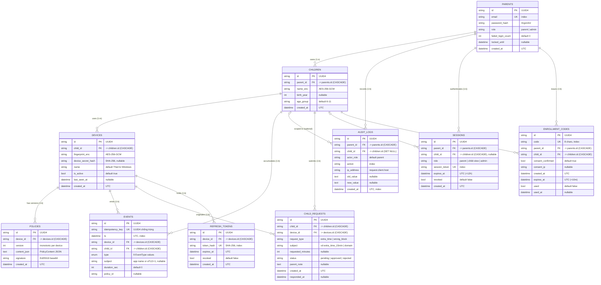

# Thiết kế Cơ sở dữ liệu & ERD — OpenGuard Kids (OGK-007)

Tài liệu đặc tả lược đồ cơ sở dữ liệu cho `openguard-server` (SQLite + SQLAlchemy), tuân thủ mô hình sở hữu **`1 parent : n child : m device`**, nguyên tắc tối thiểu dữ liệu (**NT2**), minh bạch hai chiều (**NT5**) và bảo vệ quyền riêng tư (**F5**).

---

## 1. Quy ước chung & Cấu hình SQLite

| Hạng mục | Quy ước chuẩn |
|---|---|
| **Khóa chính (PK) & Khóa ngoại (FK)** | Thống nhất dùng `str` UUIDv4 (`gen_uuid()`) trên toàn bộ 10 bảng |
| **Dấu thời gian** | `DateTime(timezone=True)`, mặc định UTC (`datetime.now(timezone.utc)`) |
| **SQLite Pragmas (`app/database.py`)** | `PRAGMA journal_mode=WAL;`<br>`PRAGMA synchronous=NORMAL;`<br>`PRAGMA foreign_keys=ON;`<br>`PRAGMA busy_timeout=5000;` |
| **Mã hóa & Toàn vẹn (F5)** | - `parents.password_hash`: Argon2id (`passlib`)<br>- `children.name_enc`, `devices.fingerprint_enc`: AES-256-GCM (`base64(nonce_12B + ciphertext_tag)`)<br>- `devices.device_secret_hash`, `refresh_tokens.token_hash`: SHA-256<br>- `policies.signature`: Ed25519 (base64 trên canonical JSON) |
| **Lưu trữ & Tự động xóa (F3)** | Dữ liệu sử dụng (`events`) và nhật ký kiểm toán (`audit_logs`) áp dụng retention **90 ngày** |

---

## 2. Sơ đồ quan hệ thực thể (ERD)

### 2.1. Tổng quan quan hệ sở hữu

```text
parents (1) ──< (n) children (1) ──< (m) devices
   │                   │                    ├──< (k) policies        (lưu lịch sử theo version)
   │                   │                    ├──< (k) events          (cùng FK child_id)
   │                   │                    ├──< (k) refresh_tokens
   │                   │                    └──< (k) child_requests  (cùng FK child_id)
   │                   ├──< (k) events
   │                   ├──< (k) child_requests
   │                   ├──< (k) audit_logs  (child_id SET NULL khi xóa trẻ)
   │                   ├──< (k) sessions    (child_id cho role="child-view")
   │                   └──< (k) enrollment_codes
   ├──< (k) audit_logs                      (append-only; trẻ xem chỉ đọc qua child-view)
   ├──< (k) sessions
   └──< (k) enrollment_codes                (ghi nhận đồng ý Nghị định 13/2023)
```

### 2.2. Sơ đồ Mermaid ERD



---

## 3. Đặc tả chi tiết 10 bảng

### 3.1. `parents` — Tài khoản phụ huynh / quản trị (`app/models/parent.py`)

| Cột | Kiểu | Ràng buộc | Mô tả |
|---|---|---|---|
| `id` | `String` | `PK` | UUIDv4 dạng chuỗi |
| `email` | `String` | `UNIQUE`, `NOT NULL`, `INDEX` | Email đăng nhập phụ huynh |
| `password_hash` | `String` | `NOT NULL` | Mật khẩu băm Argon2id (tối thiểu 10 ký tự khi đăng ký) |
| `role` | `String` | `NOT NULL`, default `"parent"` | `"parent"` \| `"admin"` |
| `failed_login_count` | `Integer` | `NOT NULL`, default `0` | Đếm số lần sai mật khẩu liên tiếp (khóa 15 phút khi ≥ 5) |
| `locked_until` | `DateTime(tz)` | `NULL` | Mốc hết hạn khóa tạm tài khoản (UTC) |
| `created_at` | `DateTime(tz)` | `NOT NULL` | Thời điểm tạo tài khoản (UTC) |

### 3.2. `children` — Hồ sơ trẻ (`app/models/child.py`)

| Cột | Kiểu | Ràng buộc | Mô tả |
|---|---|---|---|
| `id` | `String` | `PK` | UUIDv4 dạng chuỗi |
| `parent_id` | `String` | `FK -> parents.id (CASCADE)`, `NOT NULL`, `INDEX` | Phụ huynh sở hữu hồ sơ |
| `name_enc` | `String` | `NOT NULL` | Tên trẻ đã mã hóa AES-256-GCM (truy cập qua property `name`) |
| `birth_year` | `Integer` | `NULL` | Năm sinh (tùy chọn) |
| `age_group` | `String` | `NOT NULL`, default `"6-11"` | Nhóm tuổi áp dụng preset chính sách mặc định |
| `created_at` | `DateTime(tz)` | `NOT NULL` | Thời điểm tạo hồ sơ (UTC) |

### 3.3. `devices` — Thiết bị Windows của trẻ (`app/models/device.py`)

| Cột | Kiểu | Ràng buộc | Mô tả |
|---|---|---|---|
| `id` | `String` | `PK` | UUIDv4 dạng chuỗi |
| `child_id` | `String` | `FK -> children.id (CASCADE)`, `NOT NULL`, `INDEX` | Hồ sơ trẻ gắn với thiết bị |
| `fingerprint_enc` | `String` | `NOT NULL` | Hardware fingerprint mã hóa AES-256-GCM (property `fingerprint`) |
| `device_secret_hash` | `String` | `NULL` | Băm SHA-256 bí mật thiết bị |
| `name` | `String` | `NOT NULL`, default `"Thiết bị Windows"` | Tên gợi nhớ thiết bị |
| `is_active` | `Boolean` | `NOT NULL`, default `True` | `False` khi phụ huynh gỡ/thu hồi thiết bị |
| `last_seen_at` | `DateTime(tz)` | `NULL` | Lần heartbeat gần nhất từ Agent (UTC) |
| `created_at` | `DateTime(tz)` | `NOT NULL` | Thời điểm ghép đôi thiết bị (UTC) |

### 3.4. `policies` — Lịch sử chính sách theo phiên bản (`app/models/policy.py`)

| Cột | Kiểu | Ràng buộc | Mô tả |
|---|---|---|---|
| `id` | `String` | `PK` | UUIDv4 dạng chuỗi |
| `device_id` | `String` | `FK -> devices.id (CASCADE)`, `NOT NULL`, `INDEX` | Thiết bị áp dụng chính sách |
| `version` | `Integer` | `NOT NULL` | Số phiên bản tăng dần theo từng lần cập nhật (không ghi đè bản cũ) |
| `content_json` | `Text` | `NOT NULL` | Chuỗi JSON chuẩn hóa của `PolicyContent` (quota, lịch `7×48`, app/domain rules) |
| `signature` | `String` | `NOT NULL` | Chữ ký số Ed25519 (base64) để Agent xác thực tính toàn vẹn |
| `created_at` | `DateTime(tz)` | `NOT NULL` | Thời điểm phát hành version (UTC) |

### 3.5. `events` — Nhật ký sự kiện tối thiểu 7 trường (`app/models/event.py` — OGK-010/011)

| Cột | Kiểu | Ràng buộc | Mô tả |
|---|---|---|---|
| `id` | `String` | `PK` | UUIDv4 dạng chuỗi |
| `idempotency_key` | `String` | `UNIQUE`, `NOT NULL`, `INDEX` | Khóa chống trùng lặp khi Agent retry batch sync |
| `ts` | `DateTime(tz)` | `NOT NULL`, `INDEX` | Thời điểm phát sinh sự kiện (UTC) |
| `device_id` | `String` | `FK -> devices.id (CASCADE)`, `NOT NULL`, `INDEX` | Thiết bị phát sinh sự kiện |
| `child_id` | `String` | `FK -> children.id (CASCADE)`, `NOT NULL`, `INDEX` | Trẻ sử dụng thiết bị |
| `type` | `Enum(EventType)` | `NOT NULL`, `INDEX` | Đúng 9 loại: `app_start`, `app_stop`, `domain_query`, `blocked_app`, `blocked_domain`, `quota_warning`, `locked`, `unlock_request`, `override_granted` |
| `subject` | `String(255)` | `NULL` | Tên tiến trình (vd `word.exe`) hoặc tên miền cấp hai eTLD+1 (vd `youtube.com`). Cấm URL đầy đủ/path/query |
| `duration_sec` | `Integer` | `NOT NULL`, default `0` | Thời lượng sử dụng tính bằng giây (không âm) |
| `policy_id` | `String` | `NULL` | ID hoặc version chính sách đang áp dụng khi sự kiện xảy ra |

### 3.6. `audit_logs` — Nhật ký kiểm toán minh bạch (`app/models/audit.py`)

| Cột | Kiểu | Ràng buộc | Mô tả |
|---|---|---|---|
| `id` | `String` | `PK` | UUIDv4 dạng chuỗi |
| `parent_id` | `String` | `FK -> parents.id (CASCADE)`, `NOT NULL`, `INDEX` | Phụ huynh thực hiện thay đổi |
| `child_id` | `String` | `FK -> children.id (SET NULL)`, `NULL`, `INDEX` | Trẻ chịu tác động của thay đổi (giữ log khi xóa trẻ nếu cần) |
| `actor_role` | `String` | `NOT NULL`, default `"parent"` | Vai trò người thao tác |
| `action` | `String` | `NOT NULL`, `INDEX` | Tên hành động (`update_policy`, `create_enroll_code`, `revoke_device`, `lock_now`, ...) |
| `ip_address` | `String` | `NOT NULL` | Địa chỉ IP thực của client (`request.client.host`) |
| `old_value` | `Text` | `NULL` | Giá trị trước khi thay đổi |
| `new_value` | `Text` | `NULL` | Giá trị sau khi thay đổi |
| `created_at` | `DateTime(tz)` | `NOT NULL`, `INDEX` | Thời điểm ghi log (append-only, trẻ được xem chỉ đọc theo NT5) |

### 3.7. `child_requests` — Yêu cầu từ trẻ (`app/models/child_request.py`)

| Cột | Kiểu | Ràng buộc | Mô tả |
|---|---|---|---|
| `id` | `String` | `PK` | UUIDv4 dạng chuỗi |
| `child_id` | `String` | `FK -> children.id (CASCADE)`, `NOT NULL`, `INDEX` | Trẻ gửi yêu cầu (NT3) |
| `device_id` | `String` | `FK -> devices.id (CASCADE)`, `NOT NULL` | Thiết bị phát sinh yêu cầu |
| `request_type` | `String` | `NOT NULL` | `"extra_time"` \| `"wrong_block"` |
| `subject` | `String` | `NOT NULL` | Nội dung đối tượng (vd `"extra_time_15min"` hoặc domain `"hocmai.vn"`) |
| `requested_minutes` | `Integer` | `NULL` | Số phút xin thêm (với `extra_time`) |
| `status` | `String` | `NOT NULL`, default `"pending"` | `"pending"` \| `"approved"` \| `"rejected"` |
| `parent_note` | `Text` | `NULL` | Ghi chú phản hồi của phụ huynh |
| `created_at` | `DateTime(tz)` | `NOT NULL` | Thời điểm gửi yêu cầu (UTC) |
| `responded_at` | `DateTime(tz)` | `NULL` | Thời điểm phụ huynh duyệt/từ chối (UTC) |

### 3.8. `sessions` — Phiên đăng nhập Web/Dashboard (`app/models/misc.py`)

| Cột | Kiểu | Ràng buộc | Mô tả |
|---|---|---|---|
| `id` | `String` | `PK` | UUIDv4 dạng chuỗi |
| `parent_id` | `String` | `FK -> parents.id (CASCADE)`, `NOT NULL` | Tài khoản chủ sở hữu phiên |
| `child_id` | `String` | `FK -> children.id (CASCADE)`, `NULL` | Phạm vi trẻ khi `role="child-view"` |
| `role` | `String` | `NOT NULL`, default `"parent"` | `"parent"` \| `"child-view"` \| `"admin"` |
| `session_token` | `String` | `UNIQUE`, `NOT NULL`, `INDEX` | Token lưu trong cookie `HttpOnly`, `Secure`, `SameSite=Lax` |
| `expires_at` | `DateTime(tz)` | `NOT NULL` | Hạn phiên 12 giờ (UTC) |
| `revoked` | `Boolean` | `NOT NULL`, default `False` | `True` khi đăng xuất (hủy phiên phía server) |
| `created_at` | `DateTime(tz)` | `NOT NULL` | Thời điểm tạo phiên (UTC) |

### 3.9. `refresh_tokens` — Refresh token của Agent (`app/models/misc.py`)

| Cột | Kiểu | Ràng buộc | Mô tả |
|---|---|---|---|
| `id` | `String` | `PK` | UUIDv4 dạng chuỗi |
| `device_id` | `String` | `FK -> devices.id (CASCADE)`, `NOT NULL`, `INDEX` | Thiết bị sở hữu token |
| `token_hash` | `String` | `UNIQUE`, `NOT NULL`, `INDEX` | SHA-256 của refresh token (không lưu plaintext) |
| `expires_at` | `DateTime(tz)` | `NOT NULL` | Thời điểm hết hạn (UTC) |
| `revoked` | `Boolean` | `NOT NULL`, default `False` | `True` khi thu hồi thiết bị |
| `created_at` | `DateTime(tz)` | `NOT NULL` | Thời điểm cấp token (UTC) |

### 3.10. `enrollment_codes` — Mã ghép đôi & Điểm đồng ý (`app/models/enrollment.py`)

| Cột | Kiểu | Ràng buộc | Mô tả |
|---|---|---|---|
| `id` | `String` | `PK` | UUIDv4 dạng chuỗi |
| `code` | `String(8)` | `UNIQUE`, `NOT NULL`, `INDEX` | Mã ghép đôi 8 ký tự (loại bỏ `0/O/1/I`) |
| `parent_id` | `String` | `FK -> parents.id (CASCADE)`, `NOT NULL` | Phụ huynh tạo mã |
| `child_id` | `String` | `FK -> children.id (CASCADE)`, `NOT NULL` | Hồ sơ trẻ sẽ gắn thiết bị |
| `consent_confirmed` | `Boolean` | `NOT NULL`, default `True` | Xác nhận đồng ý giám sát theo Nghị định 13/2023/NĐ-CP |
| `consent_ip` | `String` | `NULL` | IP phụ huynh lúc xác nhận đồng ý |
| `created_at` | `DateTime(tz)` | `NOT NULL` | Thời điểm tạo mã (UTC) |
| `expires_at` | `DateTime(tz)` | `NOT NULL` | Hết hạn sau 10 phút (UTC) |
| `used` | `Boolean` | `NOT NULL`, default `False` | Chỉ sử dụng 1 lần duy nhất |
| `used_at` | `DateTime(tz)` | `NULL` | Thời điểm Agent ghép đôi thành công (UTC) |

---

## 4. Ràng buộc sở hữu & Chống IDOR (F5)

Mọi API truy vấn dữ liệu (`policy`, `events`, `reports`, `audit`, `requests`, `enroll/revoke`, `privacy`) bắt buộc kiểm tra chuỗi sở hữu ở tầng truy vấn SQLAlchemy, không chỉ ẩn nút trên giao diện:

1. **Thao tác của `parent` / `admin`:**
   - Truy cập `Child`: bắt buộc `Child.id == child_id` **và** `Child.parent_id == current_parent.id`.
   - Truy cập `Device` / `Policy` / `Event` / `ChildRequest`: phải join qua `Child` để xác minh `Child.parent_id == current_parent.id`.
2. **Thao tác chỉ đọc của `child-view`:**
   - Chỉ được truy vấn dữ liệu gắn với đúng `session.child_id` (`Event.child_id == session.child_id`, `AuditLog.child_id == session.child_id` hoặc log thuộc `session.parent_id` liên quan tới trẻ đó).
   - Bị chặn (`HTTP 403`) đối với mọi thao tác ghi của phụ huynh.
3. **Thao tác của Agent (Device JWT):**
   - `POST /events/batch`, `GET /policy/{device_id}`, heartbeat và WebSocket bắt buộc kiểm tra `Device.is_active == True`, `payload.device_id == current_device.id`, và `payload.child_id == current_device.child_id`.
4. **Cascade xóa dữ liệu:**
   - Xóa `Parent` → xóa cascade toàn bộ `children`, `devices`, `policies`, `events`, `child_requests`, `sessions`, `refresh_tokens`, `enrollment_codes`, `audit_logs`.
   - Xóa `Child` → xóa cascade `devices`, `policies`, `events`, `child_requests`, `enrollment_codes`, `sessions` (scope trẻ); `audit_logs.child_id` chuyển thành `NULL` (`ON DELETE SET NULL`) để bảo toàn nhật ký kiểm toán của phụ huynh.
